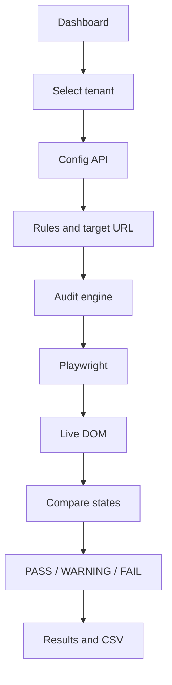

# The Judge — Multi-Tenant Configuration Drift Auditor

**Type:** Quality Engineering AI assistant / audit proof of concept  
**Domain:** Multi-tenant web application configuration  
**Interface:** Streamlit dashboard and command-line audit  
**Core technologies:** Python, FastAPI, Playwright, Pandas  
**Status:** Demonstrable proof of concept

---

## 1. What is The Judge?

The Judge is a configuration-driven auditor for checking whether a live web application matches the settings expected for a customer or tenant. It retrieves rules for the selected tenant, opens the target page in a browser, reads the live DOM, compares configured expectations with observed state, and produces a reviewable result.

The project focuses on a Quality Engineering problem that becomes harder as applications grow: the application may be shared, but each customer or environment can require different settings. A release, a manual update, or an outdated configuration can leave the expected state and the live interface out of sync.

The Judge turns that comparison into an auditable workflow. It is designed to help a QA or engineering team see what was checked, what was expected, what was observed, and where attention may be needed.

## 2. Why I built it

My background is in Quality Engineering and test automation. I wanted to apply that experience to a practical configuration problem and explore how a browser-based audit could verify application behavior against external expectations.

The central question was:

> Can an audit engine compare tenant-specific expected configuration with the actual state of a running application and produce evidence when they differ?

This project explores more than whether a page can be opened with Playwright. It separates the expected configuration from the browser inspection, then presents the comparison in a way that can be reviewed by another person.

## 3. The problem and the example

A multi-tenant application can have different rules for field visibility, required status, or enabled state. If the application changes but the configuration does not, or the configuration changes but the application does not, the two representations can diverge.

The proof of concept uses a public Practice Form Validation page as its live target. Its tenant examples use the same target URL so that the demonstration can focus on the differences between tenant rules and audit outcomes. It is a practice application, not a bank, insurer, or production tenant environment.

## 4. What The Judge does

The current prototype can:

- Retrieve tenant-specific audit rules from a mock FastAPI configuration service.
- Select a tenant from a Streamlit dashboard.
- Open the configured target page with Playwright.
- Inspect real DOM elements and read attributes and state.
- Compare the observed state with configured expectations.
- Report matching checks, configuration drift, duplicate IDs, and missing elements.
- Show result counts and row-level findings in the dashboard.
- Save or download structured CSV audit results.
- Run an audit from the command line for development and troubleshooting.

## 5. How it works

### Audit sequence

1. The dashboard checks whether the configuration API is available and lists the tenant choices.
2. The selected tenant determines the target URL and rules used for the run.
3. The audit engine retrieves the rule set from the configuration service.
4. Playwright opens the target page and reads the configured elements.
5. The engine evaluates each requested check against the actual DOM.
6. It assigns a status and a note that describes a match, mismatch, duplicate ID, or missing element.
7. The dashboard summarizes the findings and makes the structured report available.

## 6. Tenant configuration

The mock API provides a health check, a tenant listing, and a tenant configuration endpoint. The configuration response contains a target URL and the rules to evaluate for that tenant.

The API-backed examples include:

| Tenant | Intended demonstration |
|---|---|
| Practice_Bank | Banking-style configuration and drift examples. |
| Insurance_Demo | Insurance-style configuration and drift examples. |
| Retail_Demo | Retail-style configuration and drift examples. |

The mock service stores its configurations in memory. A local JSON fallback is also included for Practice_Bank. In the uploaded project package, that fallback has three rules, while the API configuration and example reports demonstrate a broader rule set. The API and fallback are not identical in the current package, so the active configuration source can affect the checks and results shown.

All three API-backed demo tenants currently point to the same public form. A production system would normally use approved tenant environments and an authoritative configuration service.

## 7. Live DOM inspection and rule types

The project includes a small inspection utility used to discover the fields and attributes that actually exist on the public form. This supports building rules around real DOM identifiers rather than inventing selectors.

The audit engine demonstrates checks for:

| Check | Example question |
|---|---|
| Element existence | Is the configured field present in the rendered page? |
| Attribute | Does the field have the expected required or other attribute value? |
| Visibility | Is the field visible to a user? |
| Disabled state | Is the field enabled or disabled as expected? |
| Duplicate ID | Do multiple elements share an ID that is assumed to be unique? |

The check is configuration-driven: the tenant rule specifies the element and expected behavior, and the engine evaluates the live page against that rule.

## 8. Understanding PASS, WARNING, and FAIL

| Status | Meaning | Example from the demonstration |
|---|---|---|
| **PASS** | The observed state matches the expected value. | A required field is present and marked required. |
| **WARNING** | The check reveals a structural ambiguity that deserves review. | Two elements share the same ID, so an ID-based locator may be ambiguous. |
| **FAIL** | The actual state differs from the expectation, or the configured element cannot be found. | A field expected to be disabled is enabled, or an expected field is missing. |

A duplicate ID is reported as a warning even if the first matching element appears to satisfy the configured check. A configuration mismatch or missing element is reported as a failure so that the result does not hide the difference behind a successful browser interaction.

## 9. Example audit findings

The sample CSVs in the project package show both successful checks and deliberate problems. Representative rows are:

| Element / check | Expected | Observed | Result | Interpretation |
|---|---:|---:|---|---|
| validationCustom01 — required | True | True | PASS | The required attribute matches. |
| validationCustom05 — required | True | True | WARNING | A duplicate ID was detected. |
| validationCustom04 — disabled | True | False | FAIL | The live field is enabled despite the expected disabled state. |
| validationCustom02 — attribute check | True | NOT_FOUND | FAIL | The configured element is absent from the DOM. |

The report records the tenant, timestamp, field ID, check type, property, expected value, actual value, status, and a note. These fields make it possible to review a run after the browser interaction has ended.

## 10. Dashboard and project components

### Streamlit dashboard

The dashboard brings the workflow into one place. It shows the API health, tenant selector, configuration source, target application, rule count, Run Audit action, PASS/WARNING/FAIL counts, detailed findings, and CSV download.

### FastAPI configuration service

The mock service exposes a health endpoint, a tenant list, and a tenant configuration endpoint. Its in-memory configuration is deliberately simple for the proof of concept and can be replaced by an approved service in a future design.

### Audit engine

The Python engine coordinates configuration retrieval, browser inspection, rule evaluation, status assignment, and CSV output. The engine can also be run from the command line, which is useful for development and troubleshooting.

### Playwright browser inspection

Playwright opens the target page and reads the live state of the elements named by the tenant rules. This makes the audit an observation of the rendered application, rather than a comparison between two static configuration files.

### CSV evidence

The CSV format keeps each result in a structured row and can be opened in a spreadsheet or passed to a later reporting process. Pipeline integration and centralized audit history are future possibilities, not current capabilities.

## 11. Quality Engineering approach

I designed the demonstration to cover more than the happy path. It includes:

| Scenario | Expected audit behavior |
|---|---|
| Configured attribute matches the page | Report PASS. |
| Configured property differs from the live state | Report FAIL with expected and observed values. |
| Configured field does not exist | Report FAIL with a not-found result. |
| Multiple elements share a configured ID | Report WARNING to expose selector ambiguity. |
| Visibility or disabled state matches | Report PASS for the individual rule. |
| API is unavailable | Use or report the configured fallback path according to the current application behavior. |

The sample tenant reports show how separate checks can produce a mix of statuses during one audit. A report with both passes and failures is useful for demonstrating that the engine is evaluating individual rules rather than treating the whole page as one binary result.

## 12. What I wanted to validate

While building this prototype, I wanted to understand:

- Can the same engine run against different tenant rule sets?
- Can an audit inspect the actual page rather than trust a static assumption?
- Does the result distinguish a value mismatch from a missing element?
- Can the audit identify a duplicate ID that makes a locator ambiguous?
- Does the output show enough evidence for another QA engineer to review it?
- Can the result be retained as a simple CSV report?
- Can the configuration, audit engine, and presentation remain separate parts of the design?

## 13. What this project demonstrates

The main idea is a repeatable comparison between **expected configuration** and **actual application state**. The expected values come from tenant rules; the actual values come from a browser inspection; the result is a structured explanation of the comparison.

This demonstrates:

- Configuration-driven test design.
- Browser-based validation of a live interface.
- Explicit expected-versus-actual reporting.
- Structural warnings as well as functional mismatches.
- Separation between data/configuration, audit execution, and presentation.
- Evidence generation that can be reviewed outside the interactive session.

## 14. Challenges and lessons

### Discovering the real page structure

The rules need to refer to elements that exist in the target DOM. The inspection utility was used to identify actual IDs and attributes before building the audit matrix.

### Treating duplicate IDs as a quality issue

A selector can return an element even when its ID is duplicated. Reporting that ambiguity separately helps prevent a misleading result from being treated as a clean pass.

### Keeping expected and observed state distinct

The report needs to show both the configured expectation and the live value. Without that distinction, a failure would not explain what changed or why the rule failed.

### Making useful failure scenarios

The demo deliberately includes drift and missing-element cases. These scenarios make the purpose of the auditor clearer than an all-pass run would.

## 15. Current limitations

This is a proof of concept, not a production configuration or compliance service. Current limitations include:

- A mock API with in-memory configuration rather than an authoritative configuration store.
- A local fallback configuration that differs from the API rule set.
- Demo tenants that share one public practice application.
- Dependence on a public target page that may change or become unavailable.
- A focused set of rule types rather than a general DOM assertion language.
- Local report files rather than centralized, historical audit storage.
- No production authentication, tenant isolation, role-based access, or scheduled audit service.
- No production browser grid, alerting, or CI/CD gate in the current prototype.

The project should not be presented as a production-ready enterprise audit system. Production use would need environment authorization, security controls, stable test targets, controlled browser execution, and reliable audit retention.

## 16. What I would improve next

If this proof of concept were extended, I would consider:

- Use a real, versioned configuration service and validate its schema.
- Make API and fallback configurations consistent and visible in audit metadata.
- Add more rule types for text, placeholder, input type, CSS or ARIA attributes, element count, and DOM structure.
- Add authentication, authorization, tenant isolation, secret management, and HTTPS.
- Run scheduled audits and retain results with tenant, time, and configuration version.
- Integrate results with an approved CI/CD pipeline or test management process.
- Add notifications for meaningful failures and a review path for warnings.
- Run browser checks in a controlled browser grid for larger workloads.

These are possible next steps, not features currently implemented in the demo.

## 17. My contribution

For this proof of concept, I designed the configuration drift use case and built the end-to-end demonstration around a mock configuration API, a Playwright audit engine, and a Streamlit dashboard. I also defined intentional match, drift, duplicate-ID, and missing-element scenarios and used CSV reports to make the results reviewable.

The emphasis was on exploring how Quality Engineering can validate expected application configuration and explain discrepancies with concrete evidence.

## 18. Technology used

| Area | Technology |
|---|---|
| Application and audit logic | Python |
| Configuration service | FastAPI and Uvicorn |
| Browser inspection | Playwright |
| Dashboard | Streamlit |
| Result handling | Pandas and CSV |
| Practice target | Public form-validation application |

## 19. Project status and demonstration flow

The current status is a demonstrable proof of concept. The documented demo flow is:

1. Start the mock configuration service and Streamlit dashboard.
2. Select Practice_Bank, Insurance_Demo, or Retail_Demo.
3. Review the displayed target and rule count.
4. Run the audit against the live practice form.
5. Review one PASS, the duplicate-ID WARNING, a drift FAIL, and a missing-element FAIL.
6. Download the CSV and inspect its expected/actual evidence.

The three tenant reports in the project package provide example outputs. Exact results depend on the active configuration source and the current state of the public target page.

## 20. Portfolio scope and disclaimer

This is an independent proof-of-concept project for learning and portfolio demonstration. It is not an official application or deployment for any bank, insurer, retailer, or other organization. The demo tenant names are examples and do not represent customer environments.

This README explains the project and its behavior. The public portfolio shares documentation and selected reviewed evidence; it does not publish the full working application source, local environment files, or credentials.
