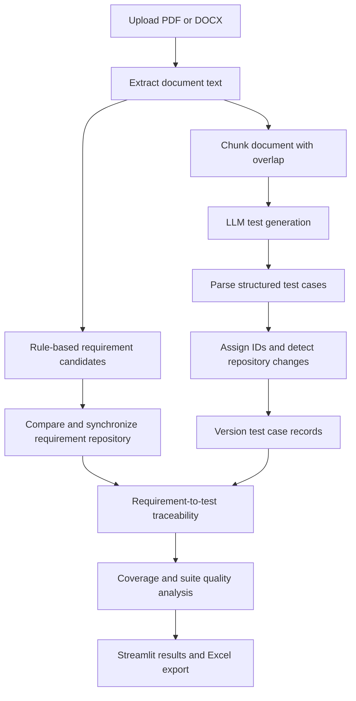

# RARE — Requirement Analysis and Response Engine

**Type:** AI Test Engineering Assistant proof of concept  
**Domain:** Requirements analysis and test design  
**Interface:** Streamlit web application  
**Input:** PDF and DOCX requirement documents  
**Output:** Versioned master test suite, coverage and quality findings, Excel workbook  
**Status:** Demonstrable proof of concept

---

## 1. What is RARE?

RARE is a requirement-to-test-design assistant built around a Quality Engineering workflow. It accepts requirement documents, extracts candidate requirements, generates structured test cases with a language model, and compares the result with locally stored requirement and test case repositories.

The project is designed to make the generated suite easier to review and maintain. It connects requirements to test cases, highlights possible gaps and duplicates, and summarizes how a new generation changes the existing suite.

RARE helps create and analyze test documentation. It does not execute the generated test cases against a live application.

## 2. Why I built it

My background is in Quality Engineering and test automation. I wanted to explore how AI could support the work that happens before automated test execution: reading requirements, identifying testable conditions, organizing test cases, and keeping the suite aligned as requirements change.

The central question was:

> Can an AI-assisted workflow generate a useful test suite from requirement documents and keep that suite traceable and reviewable over time?

The project also gave me a way to examine where AI helps, where deterministic rules are more predictable, and where a human reviewer still needs to make the decision.

## 3. What RARE does

The current application can:

- Accept one or more PDF or DOCX requirement documents.
- Extract readable document text and divide it into overlapping chunks.
- Identify candidate requirements using deterministic wording and heading rules.
- Compare extracted requirements with the stored requirement repository.
- Generate structured test cases from document chunks using the configured LLM client.
- Parse generated Markdown tables into test case records.
- Assign test case IDs and compare generated cases with the existing repository.
- Summarize KEEP, MODIFY, ADD, RETIRE, and REVIEW decisions.
- Maintain versions and status for repository records.
- Map requirements to test cases and calculate coverage.
- Analyze suite quality, including gaps and near-duplicate candidates.
- Display the master suite and analysis in Streamlit.
- Export the current suite as an Excel workbook.

## 4. End-to-end workflow

The main stages are shown to the user as generation progresses. If no documents are uploaded, no readable text is found, or the generation cannot be parsed into cases, the application reports the issue instead of presenting an empty result as a successful suite.

## 5. Document ingestion

The upload interface accepts PDF and DOCX files. The application extracts text, combines readable content, and splits it into contextual segments before sending those segments for test generation. The current chunk configuration uses 7,000 characters with 600 characters of overlap.

The overlap is intended to retain some context across chunk boundaries. It does not guarantee that every table, cross-reference, or multi-page rule will be interpreted correctly. The current package uses text parsers for PDF and DOCX; no OCR step is visible in the workflow, so a scanned image-only PDF may not yield readable text.

## 6. Requirement extraction

Requirement extraction is deterministic and rule-based in the current implementation. It scans document text for requirement-style wording such as must, should, shall, required, mandatory, only if, greater than, or less than. Explicit module headings are used to associate subsequent lines with a module.

For each candidate, RARE assigns a requirement ID and derives a type and priority from keyword rules. It also stores source-document information. This predictable approach is useful for a prototype, but it is not semantic understanding:

- A real requirement may be missed if its wording does not match the configured rules.
- A sentence may be selected because it contains a keyword even when it is not a requirement.
- Module headings and document formatting can affect the result.
- Type and priority are inferred from words, not confirmed business impact.

The extracted list should therefore be reviewed against the original requirement document.

## 7. Requirement repository and synchronization

RARE compares newly extracted candidates with existing requirement records and reports synchronization actions:

| Action | Meaning in the review workflow |
|---|---|
| **KEEP** | The candidate corresponds to a requirement that remains unchanged. |
| **MODIFY** | A stored requirement appears to have changed. |
| **ADD** | A new candidate has no matching stored requirement. |
| **RETIRE** | A stored requirement may no longer appear in the current input. |
| **REVIEW** | The comparison is uncertain and needs a person to decide. |

The application displays the decisions and reasons. It deliberately does not use an incomplete extraction as authorization to retire unmatched requirements. If a generation or parse is incomplete, unmatched records are kept for review rather than treated as deleted requirements.

## 8. AI test generation and grounding

The test generator combines the project prompt with each document segment and sends the request to the configured LLM provider. The prompt asks the model to use the supplied requirement text as the source of truth, avoid inventing undocumented behavior, and return a structured Markdown table.

The application parses the first matching test-case table into structured records. If the expected table cannot be parsed, that segment does not silently become a successful test suite. The model can still misunderstand a requirement, omit a case, produce unsupported expectations, or return an invalid table, so human review is part of the workflow.

## 9. Test case format

The master suite uses these fields:

| Field | What it records |
|---|---|
| Test Case ID | Identifier assigned to the test case. |
| Module | Requirement or functional area. |
| Scenario | Business-readable condition under test. |
| Pre Condition | State needed before executing the case. |
| Test Steps | Actions needed to exercise the scenario. |
| Expected Result | Observable outcome to verify. |
| Priority | P0, P1, P2, or P3 classification. |
| Type | Positive, Negative, E2E, or Edge Case. |
| Suite Type | Smoke, Sanity, or Regression. |
| Automation Type | UI Automation, API Automation, or Backend/DB. |

The prompt includes rules intended to keep these fields consistent, require sequential IDs within generated output, and avoid unsupported error messages or API/database assumptions. These are generation constraints, not a substitute for reviewing the requirement and the returned cases.

## 10. Test case repository and change handling

Generated cases are parsed, assigned IDs across document chunks, and compared with the existing test case repository. The change detector classifies records as KEEP, MODIFY, ADD, RETIRE, or REVIEW. The version manager applies the detected changes and preserves version and status information in the repository model.

This approach is intended to prevent every regeneration from becoming a completely new list. It also makes changes visible for review. The app does not authorize retirement candidates when generation is incomplete; uncertain cases are surfaced as REVIEW.

The prototype persists requirement, test case, and traceability records in local JSON files. This provides a simple repository for a local demonstration, but it is not a multi-user or production-grade database.

## 11. Requirement-to-test traceability

RARE builds links between requirements and active test cases. An explicit requirement reference is used when one exists. The current automatic mapping also compares shared words and module names between requirement text and test case details.

The dashboard can show covered requirements, uncovered requirements, and test cases without mappings. Because word overlap is only an approximate matching method, an automatic link can be missing or incorrect. Review the mapping against the source requirement before treating it as authoritative.

## 12. Coverage analysis

The coverage report summarizes:

- Total requirements.
- Requirements with one or more linked test cases.
- Requirements with no linked test case.
- Test cases that are not mapped to a requirement.
- Requirement coverage percentage.

The goal is to make omissions easier to notice during review. A coverage percentage is a measure of links in the repository, not proof that the tests are complete, correct, or sufficient.

## 13. Test-suite quality analysis

The quality analyzer evaluates the stored suite and reports several indicators:

- Requirement gaps and reasons a requirement may lack adequate coverage.
- Duplicate or near-duplicate test case candidates based on similarity.
- Coverage of higher-priority requirements by high-priority test cases.
- Automation coverage and the distribution by automation type.
- Test type distribution across positive, negative, end-to-end, and edge cases.
- Requirements covered by only one test case.
- An overall quality score calculated from the analyzer findings.

These are review signals. A suspected duplicate or quality gap should be assessed by a QA professional rather than automatically accepted as a defect.

## 14. Streamlit dashboard and export

The application shows progress through document extraction, requirement synchronization, chunking, generation, parsing, repository comparison, versioning, traceability, coverage, and quality analysis. It presents the final suite in a table with a repository summary and offers an Excel workbook download.

The change summary groups decisions by action and can show the reason for each requirement or test case decision. The analysis view displays coverage measures, uncovered requirements, unmapped cases, quality indicators, duplicates, priority coverage, automation coverage, and test type distribution.

## 15. Application components

| Component | Responsibility |
|---|---|
| Streamlit app | Uploads documents and orchestrates the end-to-end workflow. |
| PDF/DOCX ingestion | Extracts text from supported file types. |
| Requirement extractor | Identifies candidate requirements and assigns basic metadata using rules. |
| LLM client and test generator | Sends document chunks for test generation and parses structured output. |
| Requirement and test repositories | Stores local records and supports synchronization and change detection. |
| Version manager | Applies changes while retaining record versions and statuses. |
| Traceability service | Stores requirement-to-test links and provides lookup and coverage operations. |
| Quality analyzer and report | Summarizes gaps, duplicates, coverage, and suite indicators. |
| Excel export | Creates a workbook for reviewing the master test suite. |

The source package also includes a requirement-change impact analyzer for finding test cases associated with changed requirements. It is a supporting service in the codebase; it is not presented as a separate interactive impact screen in the current upload workflow.

## 16. Testing approach

I approached RARE from a test engineering perspective: validate document handling, verify that repository changes are visible, check that generated rows can be parsed, and look for gaps and ambiguity in the final suite.

Representative scenarios for reviewing this workflow include:

| Scenario | Expected behavior to review |
|---|---|
| Upload a readable BRD or FSD as PDF or DOCX | Text is extracted and the generation stages are shown. |
| Upload no document | The app requests a document instead of generating an empty suite. |
| Upload a document with no readable text | The app reports that no readable content was found. |
| A requirement is not recognized by keyword rules | It is identified as an extraction limitation and checked against the source. |
| A newly extracted requirement matches a stored one | The synchronization decision is reviewed as KEEP or MODIFY. |
| A candidate cannot be matched confidently | It is surfaced for REVIEW rather than silently accepted. |
| LLM output has no parseable test table | The app reports parsing failure instead of presenting a complete suite. |
| A document is processed in multiple chunks | IDs are resolved across generated segments before repository comparison. |
| Generation is incomplete | Unmatched existing records are not retired on the basis of incomplete output. |
| A requirement has no mapped test | It appears as an uncovered requirement for review. |
| Two test cases look very similar | They are reported as duplicate candidates, not automatically deleted. |

The uploaded source package contains unit and integration test modules for repository changes, synchronization, document-to-repository flow, suite analysis, reporting, and traceability coverage. The package also contains manual validation utilities. This README describes the test areas represented in the source; it does not claim a particular test pass rate.

## 17. What I wanted to validate

While developing the prototype, I wanted to understand:

- Can requirement documents be turned into structured test cases in a repeatable workflow?
- Can the suite remain connected to its source requirements?
- Can regeneration distinguish new, changed, unchanged, and uncertain repository records?
- Can incomplete AI output avoid retiring existing records by mistake?
- Can the dashboard make coverage and quality gaps visible?
- Can the generated suite be exported for review outside the app?
- Which decisions are suitable for deterministic rules, and which still need human judgment?

## 18. What this project demonstrates

RARE demonstrates a broader test design lifecycle than a one-time prompt-and-response interaction:

**Requirement document → candidate requirement repository → generated test suite → change comparison and versioning → traceability → coverage and quality review → downloadable workbook.**

The main Quality Engineering ideas are requirement grounding, change awareness, stable repository records, reviewable AI output, and explicit visibility of coverage gaps. It also shows that an AI-generated suite needs a surrounding workflow for parsing, identity, persistence, and quality review.

## 19. What I learned

The project highlighted that an LLM is only one part of a test-generation system. Document extraction, requirement identification, prompt design, structured parsing, case identity, repository change handling, and human review all affect the result.

I also learned that deterministic rules have useful boundaries. They are predictable, but keyword matching cannot replace understanding the full requirement. Likewise, text overlap can suggest traceability links, but it cannot prove that a test case fully covers a requirement.

## 20. Challenges

### Long and structured requirement documents

Tables, headings, and formatting can carry important requirements. Extracted text and chunk boundaries may not preserve every relationship in the source document.

### Keeping generation grounded

A fluent test case can still include behavior that the source never specified. The prompt asks the model not to invent details, but the generated cases still need comparison with the document.

### Comparing regenerated suites

Small wording changes can make it difficult to determine whether a case is new, modified, or equivalent to an existing one. Repository change detection and REVIEW outcomes help expose uncertainty, but do not remove it.

### Matching requirements to cases

Word overlap is an approximate mapping signal. It may connect related wording, but it can also create weak or missed links that need manual review.

## 21. Current limitations

RARE is a proof of concept, not an autonomous test-authoring platform. Current limitations include:

- Requirement identification and classification rely on deterministic keyword rules.
- Priority is inferred from wording rather than confirmed business impact.
- PDF and DOCX text parsing may lose structure; no OCR step is present in the current workflow.
- Chunking can separate related rules or context.
- LLM output may be incomplete, inconsistent, or unsupported by the source.
- Markdown parsing depends on the expected table format.
- Automatic traceability uses text overlap and module matching, so mappings need review.
- Repository data is stored in local JSON files without production multi-user controls.
- Generated test cases are documentation; the app does not execute them against a product.
- The app sends document chunks to a configured external LLM provider.

## 22. What I would improve next

If I took RARE further, I would consider:

- More robust requirement extraction that preserves tables and source references.
- A review screen for confirming requirement candidates before synchronization.
- Human approval of requirement and test case changes before applying versions.
- Stronger traceability using explicit requirement references and reviewable match explanations.
- Improved handling of partial generations and chunk-to-document citations.
- Evaluation datasets for groundedness, omission, duplication, and unsupported expectations.
- A database with access control and audit history instead of local JSON storage.
- A provider configuration indicator that matches the active LLM selection.
- Export formats and integrations suited to a team’s test management workflow.

These are possible improvements, not capabilities claimed for the current version.

## 23. My contribution

For this proof of concept, I designed and implemented the document-to-test workflow and its supporting repository services. The project package includes components for document ingestion, rule-based requirement extraction, LLM test generation, test case parsing and identity, change detection, version management, traceability, coverage, quality analysis, and Excel export.

My focus was not only to generate test cases, but also to explore how a QA team could review changes, see gaps, and preserve a connection between requirements and the suite.

## 24. Technology used

| Area | Technology |
|---|---|
| User interface | Streamlit |
| Document parsing | PyPDF2 and python-docx |
| LLM integration | OpenAI-compatible client configuration for Groq and Gemini |
| Data validation and models | Python dataclasses and Pydantic in the project dependencies |
| Local repositories | JSON files |
| Analysis and output | Python, Pandas, and OpenPyXL |
| Validation assets | Unit tests, integration tests, and manual validation scripts |

The source package includes Groq and Gemini settings. The current UI label says “Powered by Gemini,” but the LLM client tries Groq first and Gemini second when both keys are configured. The settings comments also describe a different primary/fallback order. This provider-label and ordering mismatch should be resolved before the UI label is relied on.

## 25. Project status

The current package contains a Streamlit workflow and local repositories for demonstrating document analysis, generation, change handling, traceability, and quality review. It should be treated as a proof of concept. Generated cases, extracted requirements, and automatic mappings need human review before they are used as a team’s authoritative test assets.

## 26. Data handling and disclaimer

The application reads uploaded requirement documents and sends document chunks to the configured language-model service for test generation. Use only documents approved for that provider and demo environment. Do not publish API keys, environment files, repository data, or real customer requirements in the portfolio.

This is an independent learning and portfolio project. It is not a production test management platform and does not guarantee complete or correct requirements coverage. The public repository contains project documentation and selected reviewed evidence; it does not contain the full working application source or local data repositories.
